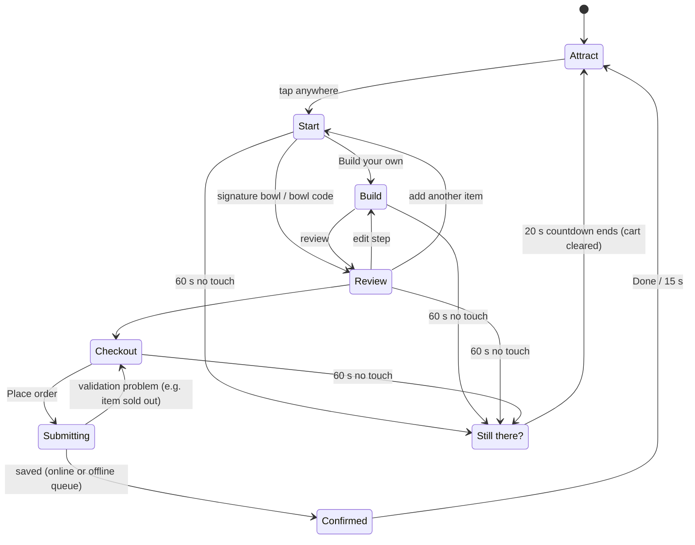
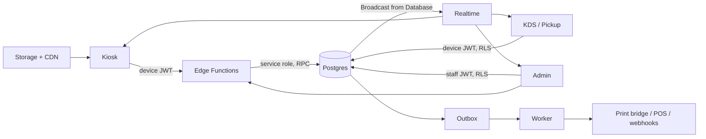

# Build Prompt: Build-Your-Bowl Kiosk (v3)

This prompt builds a production-grade self-order kiosk system for a fast-casual bowl restaurant. Customers build their own bowl on a touchscreen and see the price, calories and macros update with every tap. It also covers the kitchen display, pickup board, label printing, admin back office, database, APIs, design system, accessibility, security, operations and the roadmap.

**What's new in v3:**
- A full UI specification and design system (W3C design tokens, OKLCH color, contrast-checked).
- Frontend and backend architecture, plus an API contract.
- A tested Postgres schema with Row Level Security.
- Group orders, tax-inclusive regions, EU/UK allergens, and label printing.
- Observability, a threat model and a future-proofing roadmap.

[`RESEARCH.md`](RESEARCH.md) has the sources behind each decision.

## How to use it

1. Fill in **Make it yours** below (or keep the defaults).
2. Give the builder the files, not only this text, if your tool accepts them:

| File | Why |
|---|---|
| `PROMPT.md` → save as `SPEC.md` | This spec |
| `data/seed-menu.json` (+ `.schema.json`) | The canonical menu data. Use it instead of retyping tables |
| `design/tokens.css`, `design/tokens.*.json` | Ready-made, contrast-checked design tokens |
| `database/*.sql`, `database/tests/*` | Tested schema, RLS, RPCs, seed and 60 tests |
| `prototype/index.html` → `reference/prototype.html` | What the kiosk should look and feel like |

3. Run it in phases with [`PHASES.md`](PHASES.md). Tools that only take pasted text (Lovable, Bolt, v0) can use this file alone; everything they need is inside it.

## Make it yours

| Setting | Default | Your value |
|---|---|---|
| Restaurant name | **Bowl Lab** | |
| Food style | Build-your-own bowls: grains/greens, grilled proteins, veggies, sauces | |
| Region preset (§16) | **US**: USD, tax added at checkout, US 9 allergens, kcal | US / Canada / EU / UK / Philippines |
| Languages | English, Spanish | |
| Brand colors | Basil green + chili orange (in `design/tokens.css`) | |
| Kiosk hardware | 10–13" tablet landscape, and 22–32" portrait touchscreen | |
| Payment (v1) | Pay at the counter (card reader in milestone 8+) | |
| Tipping prompt | **Off** | |
| Local menu warnings | None (NYC sodium and added-sugar icons available) | |
| Label printer | None in v1 (designed in; see §12) | |

---

## START OF PROMPT

### 0. Your role and how to work

You are a complete senior product team: product designer, design-system lead, frontend architect, backend architect, database architect, accessibility specialist and QA lead. Build a **production-quality self-order kiosk system for a fast-casual bowl restaurant** called **Bowl Lab**. Customers build bowls on a touchscreen and see the **price, calories, protein, carbs, fat, fiber, sugar and sodium update live**. Orders flow to a kitchen display, a pickup board and (later) a label printer. Owners run everything from an admin back office.

**Working agreement**
- Read this whole spec before writing code. Build milestone by milestone (§22). A milestone is done only when the app runs, all tests pass and `README.md` says how to run it.
- If these files exist in the project, use them as the source of truth and don't retype their contents:
  - `data/seed-menu.json`
  - `design/tokens.*`
  - `database/*.sql` and `database/tests/*`
  - `reference/prototype.html`

  If you must change one, record why.
- Record architecture decisions as short ADRs in `docs/adr/NNNN-title.md` (context, decision, consequences). Record assumptions in `ASSUMPTIONS.md`.
- Work autonomously. Ask only when truly blocked.
- **Never invent nutrition or allergen data.** Use the seed values, and mark them as estimates.
- **Definition of done for every feature:** typed, unit-tested, keyboard- and screen-reader-operable, axe-clean, translated (no hard-coded strings), correct in both themes and both kiosk orientations, emits its analytics event, documented.

### 1. Product principles

1. **Fast for regulars, easy for first-timers.** Signature bowl in **≤ 6 taps** from the attract screen. A first custom bowl in **under 60 seconds** without help. Ask only what's needed to make the food. Dine-in/take-out and name are asked at checkout.
2. **Numbers are always visible and always right.**
   - Every tap updates totals in **under 100 ms**, using exactly the math in §6.
   - Calories appear next to every item, bowl and drink.
   - The server recomputes everything. The client is never trusted.
3. **Neutral, never preachy.** Nutrition is information, not judgement. No "bad food" red, no "guilt" or "cheat" language, and over-goal states use neutral colors.
4. **Trustworthy dietary info.** Filters and allergen flags must be correct every time. When in doubt, show the cross-contact disclaimer and pass the allergy note to the kitchen.
5. **Respectful selling.**
   - At most one relevant suggestion per order.
   - No tipping screen by default, no pre-selected add-ons, no fake urgency.
6. **Accessible to everyone,** including blind, low-vision and wheelchair users. This is a legal requirement in many places (§8).
7. **Never lose an order.** Offline, crashes, double taps and retries must not drop or duplicate an order.
8. **Staff stay in control.** Menu, prices, availability and devices are managed without a developer, with preview, audit and rollback.
9. **Built to grow.** One store today. Many locations, brands, regions, channels (phone, staff, API, AI assistants) and hardware (card readers, label printers, scales) later, without a rewrite.

### 2. Users and surfaces

| Surface | Users | Device | v1 |
|---|---|---|---|
| **Kiosk** | Customers | Tablet or touchscreen at the counter | Yes |
| **Kitchen Display (KDS)** | Line and grill cooks | Screen per station, optional USB bump bar | Yes |
| **Pickup board** | Waiting customers | TV near the pickup shelf | Yes |
| **Admin** | Owner, managers, staff | Laptop, tablet or phone | Yes |
| **Print bridge** | — | Small always-on computer on the store network | Designed, built in milestone 8+ |
| **Phone ordering** (QR) | Customers in line or nearby | Their phone | Extension point |
| **Staff assist** ("line buster") | Staff during rush | Handheld | Extension point |
| **Public API / AI agents** | Partners, assistants | — | Extension point |

### 3. Domain model

| Concept | Meaning |
|---|---|
| Organization → Brand → Location | Tenant hierarchy. A brand owns a menu; a location serves a published version of it with its own prices, tax, currency, timezone and availability |
| **Product** | Something you can order. `configurable` (bowl, protein cup, later salads, wraps, smoothies) or `simple` (drinks) |
| **Option group** | A builder step of a configurable product (Base, Protein, Veggies, Toppings, Sauce) with min/max/included rules |
| **Ingredient** | An option inside groups, with nutrition per Regular portion, allergens, diet tags, color and grams |
| **Portion** | Light (0.5×), Half (0.5×, half & half only), Regular (1×), Extra (1.5×), Double (2×) |
| **Line** | One chosen ingredient with a portion (and "on the side") |
| **Bag** | Everything in the current order: one or more bowls (each optionally named), cups, drinks |
| **Menu version** | An immutable, published snapshot of the brand's menu. Kiosks load one; orders reference it |
| **Availability** | Per-location sold-out state and optional "86 counts" |
| **Order** | A placed bag with a number, snapshot lines, totals and status history |
| **Device** | A paired kiosk, KDS, pickup board or print bridge, signed in as its own user |
| **Session** | One customer's visit on a kiosk, from first tap to reset. Anonymous |

Bowls are just the first configurable product. **Write the builder, pricing and nutrition engine against option groups, never against "bowl" specifically.**

### 4. Customer experience (Kiosk)

**4.1 Session flow** (implement as an explicit state machine; see §9.3)


Idle times are tripled when accessibility mode is on, and "I need more time" extends them (WCAG 2.2.1).

**4.2 Screens**

| Screen | Content | Primary action | States to design |
|---|---|---|---|
| **Attract** | Looping food imagery or a slowly turning bowl, name, "Tap to order", language and accessibility buttons. Content shifts slightly every minute to protect the screen from burn-in | Tap anywhere | Offline (still usable), menu loading (cached), maintenance ("Please order at the counter") |
| **Start** | Big "Build your own bowl" card; signature bowls (price, calories, protein, badges); "Have a bowl code?"; optional goal chips and diet filters; "Protein cups" and drinks row | Build / pick a signature | Filters hide nothing (dim only); a sold-out signature shows "Sold out today" |
| **Builder** | §5 | Next | Step full, sold out, filtered out, goal off-track, offline |
| **Review (Bag)** | Every item with its lines, label name, quantity stepper, Edit, Remove (with Undo for 5 s); nutrition table per item; allergens and diet tags; one suggestion; subtotal, discount, tax, total; promo code entry (if enabled) | Checkout | Empty bag; item became unavailable (inline fix: "Avocado sold out. Pick a replacement"); price changed after a menu update |
| **Checkout** | One screen: Dine in / Take out, optional first name (custom keyboard), payment (v1: pay at counter), "Place order · $X" | Place order | Submitting (button shows progress, can't double-submit); ordering paused; failure with retry |
| **Confirmation** | Huge order number, name, "Pay at the counter" / "We're making it", wait estimate, QR to web receipt with full nutrition and bowl codes | Done | Offline: number from the device range and "Show this screen at the counter" |
| **Bowl code** | 6-character code entry with a large custom keypad (no ambiguous characters) | Load bowl | Not found; expired; some items changed (flagged for replacement) |
| **Accessibility sheet** | Reach mode, larger text, high contrast, read aloud, more time | Toggle | — |
| **Language sheet** | Languages in their own names ("English", "Español") | Pick | Missing translations fall back to the default language, never show keys |
| **Allergen sheet** | The allergens of the location's regime (§6.6) as large toggles | Apply | — |
| **Staff menu** | Hidden: 5 taps top-left in 3 s + PIN | Reload, sold-out toggles, queue status, device info, exit kiosk | Wrong PIN (lock 60 s after 5 tries) |

**4.3 Group orders.** A bag can hold up to 20 items. Each bowl can carry a **label name** ("Sam", "Mom") that prints on its sticker and shows on the KDS. "Make another like this" duplicates a bowl. Quantity steppers for cups and drinks.

**4.4 Tap budget.** Attract → signature → Checkout → Dine in → Place order = 5 taps. Building a bowl: 1 tap per ingredient, 1 per step change; never a scroll needed to reach Next.

### 5. The builder

**5.1 Layout**
- **Landscape:** step track across the top (Base → Protein → Veggies → Toppings → Sauce → Review). The ingredient grid takes ~65% on the left and scrolls by itself. A persistent **Your Bowl panel** takes ~35% on the right. The page never scrolls.
- **Portrait (≥ 1500 px tall):** step track on top, grid in the middle, the panel as a bottom sheet. Collapsed, the sheet always shows calories, protein, price and Next. All primary actions sit in the lower half of the screen for reach.
- Back and Next are always in the same place. Next is disabled with a reason ("Pick a base to continue") until rules are met; optional steps show **Skip** until something is picked.
- **Auto-advance** only on single-choice steps (Protein), after showing the selection for 400 ms. After Base and Protein are chosen, a **Review bowl** shortcut is always visible.

**5.2 Ingredient cards** (container-query responsive)
- **Content:** photo or illustration, name, **calories**, protein, a price badge only when it costs extra, allergen chips (icon + word), diet tags, and an optional badge ("High protein", "Popular", "New").
- **Selecting:** tap to add (checkmark + 2 px primary border). A selected card shows the **portion selector**: Light / Regular / Extra (Double for proteins), each with its calorie and price difference (`Double +190 cal · +$3.50`). Remove (×) has a 48 px minimum target in the corner.
- **Step full:** the card shakes gently once and a message explains: "Up to 4 veggies. Remove one to swap."
- **Sold out:** greyed out with "Sold out", not tappable, sorted last.
- **Filtered out:** dimmed with the reason ("Contains milk"). Tapping asks "Add anyway?"
- **Goal active:** the card shows its effect ("+35 g protein").

**5.3 Your Bowl panel**
- A top-down **bowl illustration that fills up**: each ingredient appears in its own color and shape, and a newly added ingredient flies from its card into the bowl (a shared-element View Transition, ≤ 300 ms; no flight with reduced motion).
- **Nutrition view toggle:**
  - **Simple** (default): calories + protein.
  - **Full:** calories, protein, carbs, fat, fiber, sugar, added sugar and sodium. Bars show % Daily Value, plus a macro ring (share of calories from protein × 4, carbs × 4, fat × 9).
  - The choice lasts for the session.
- Numbers tick to new values in ≤ 250 ms with tabular figures, so nothing jitters.
- Goal progress (5.5), chosen ingredients with portions (tap to jump to their step), and the price.

**5.4 Step rules** come from the product's option groups (defaults below; all editable in Admin):

| Group | Required | Min | Max | Included | Notes |
|---|---|---|---|---|---|
| Base | Yes | 1 | 2 | 2 | 2 picks = **half & half**: both become Half (0.5×), portion selector hidden |
| Protein | Yes | 1 | 1 | — | **Sets the bowl price.** "No protein (veggie bowl)" is valid. Light / Regular / Double (paid) |
| Veggies | No | 0 | 4 | 4 | Light / Regular / Extra, free |
| Toppings | No | 0 | 5 | 2 standard | Each standard topping after the 2nd: $0.75. **Premium** toppings always cost their price and don't use free slots |
| Sauce | No | 0 | 2 | 2 | Light / Regular / Extra; **On the side** toggle (same nutrition, flagged for kitchen and label) |

**5.5 Goals** (optional, never block ordering)

| Preset | Target |
|---|---|
| High protein | Protein ≥ 40 g |
| Lighter | Calories ≤ 450 |
| Under 600 | Calories ≤ 600 |
| Low carb | Carbs ≤ 30 g |
| Balanced | No target; macro ring shown prominently |
| Custom | Calories / protein / carbs / fat targets via +/- steppers (no typing) |

- Status: "On track" or "80 cal over goal" in a neutral color.
- **Suggestions engine** (deterministic, rule-based, explainable):
  - Generate candidate one-tap changes: change a portion, swap within a step, or add to a step with room.
  - Keep only candidates that are available, match active filters and move the goal metric toward the target.
  - Rank by improvement, then by smallest price increase. Show the top 2, from different lines.
  - Each suggestion shows its effect and its price ("Swap white rice for cauliflower rice · −155 cal · no extra cost").

**5.6 Dietary filters and allergens**
- Diet tags (reference data): vegan, vegetarian, gluten_free, dairy_free, pescatarian, halal, kosher. Vegan implies vegetarian.
- Allergens follow the location's **regime** (§6.6). Ingredients can be `contains` or `may contain`.
- Filtered-out items are **dimmed, not hidden**, with the reason, and need confirmation to add.
- A bowl's tags are derived (a bowl is vegan only if every line is vegan). Its allergens are the union of its lines' allergens. Show both on Review and on the label.

**5.7 Mid-session changes**
- If an item in the bag sells out, show a friendly inline notice on Review with the two closest available swaps (same step, nearest calories).
- If a new menu version is published, it applies at the next reset, never mid-session.
- If a price changed, the server re-quotes at Place order and the UI shows the difference before submitting.

### 6. Nutrition, allergens, pricing, tax and labeling

**6.1 Portions.** Ingredients store nutrition for **one Regular portion** (`data/seed-menu.json`). A line's nutrients = Regular values × multiplier (Light 0.5, Half 0.5, Regular 1, Extra 1.5, Double 2). Grams = `servingGrams × multiplier`.

**6.2 Totals.** Item total = sum over lines. Bag totals are per item, never merged into one number for the customer. **Sum at full precision, round only for display.**

**6.3 Display rounding** (US FDA style, round-half-up):
- Calories: < 5 → 0; 5–50 → nearest 5; > 50 → nearest 10.
- Grams (protein, carbs, fat, fiber, sugar, added sugar): < 0.5 → 0; otherwise nearest 1.
- Sodium: < 5 mg → 0; 5–140 → nearest 5; > 140 → nearest 10.
- **Energy in kJ** (EU and UK presets): kJ = kcal × 4.184, rounded to the nearest 1, shown as "2218 kJ / 530 kcal".

**6.4 Nutrient registry.** Nutrients are reference data (code, name, unit, daily value), so new ones (saturated fat, potassium, caffeine...) need no code change. The kiosk shows the 8 core nutrients. The **full nutrition information page** (QR on Start and receipts, for "available upon request") shows every nutrient the menu has.

**6.5 Money and tax.** Integer minor units only; never floats. Format with `Intl.NumberFormat(locale, {style: 'currency', currency})`.
- Item price = base price (from the price-setting group) + portion deltas + paid extras (premium, beyond-included) × quantity.
- Order: subtotal → discount (promo, rounded half-up to the minor unit, never below 0) → tax → total.
- **Exclusive tax** (US, CA): tax = round_half_up((subtotal − discount) × rate); total = subtotal − discount + tax.
- **Inclusive tax** (EU, UK, PH): menu prices include tax. Tax shown on the receipt = round_half_up((subtotal − discount) × rate / (1 + rate)); total = subtotal − discount.
- Rates are stored in basis points (800 = 8%).

**6.6 Allergen regimes**

| Regime | Allergens |
|---|---|
| **US9** | milk, egg, fish, crustacean shellfish, tree nuts, peanuts, wheat, soy, sesame |
| **EU14** (EU, UK) | cereals containing gluten, crustaceans, eggs, fish, peanuts, soybeans, milk, tree nuts, celery, mustard, sesame, sulphites, lupin, molluscs |
| **CA** | Canada's priority allergens (configured in Admin) |

All codes live in one reference table with the regimes they belong to. Admin's allergen editor shows the checklist for the location's regime and won't publish an ingredient with an unanswered allergen.

**6.7 Warning icons** (per location; off by default): high sodium (≥ 2,300 mg per item) and high added sugar (≥ 50 g per item). Icon artwork and statement text come from Admin so any city's rule (e.g. New York City) can be met.

**6.8 Required text** (per regime, editable in Admin; US defaults):
- "2,000 calories a day is used for general nutrition advice, but calorie needs vary."
- "Additional nutrition information available upon request."
- "Nutrition values are estimates. Bowls are made by hand, so portions may vary."
- "Our kitchen handles all major allergens. We can't guarantee any item is free of allergens."

**6.9 Data quality.**
- Each ingredient records its nutrition **source** (lab, recipe calculation, supplier, estimate) and a verified date.
- Admin warns when calories differ from 4P + 4C + 9F by more than 15% and 10 kcal.
- Publishing is blocked if any nutrient or allergen answer is missing.

### 7. Design system and UI specification

**7.1 Direction: "fresh market, precise numbers."** Food-forward and warm, with numbers treated as the hero. Legible at arm's length in a bright, busy dining room.
- **Use:** modern platform features (OKLCH color, container queries, View Transitions, variable fonts, `text-wrap: balance`).
- **Avoid:** translucent glass over content (Apple's Liquid Glass drew wide readability criticism), neumorphism, gradients behind text, decorative motion.
- **Take** bold shapes and confident type in the spirit of Material 3 Expressive, sparingly.

**7.2 Tokens** (three tiers, W3C Design Tokens 2025.10 format)
- **Primitive:** color ramps in OKLCH (neutral, basil, chili, protein, carbs, fat, fiber, red; steps 50–950), type, space, radius, size, duration, easing → `design/tokens.primitives.json`.
- **Semantic** (what components use): `design/tokens.light.json`, `design/tokens.dark.json`.
- **CSS:** `design/tokens.css`, generated with light/dark/`data-theme` blocks. Map it into Tailwind v4 with `@theme`. Components never use raw colors.
- **Brand overrides** from Admin change semantic tokens only. The server rejects any override that drops a text pair below 4.5:1 (or a control border below 3:1), using the same contrast function.

| Role | Light | Dark | Use |
|---|---|---|---|
| `bg` | `#F5F7F5` | `#1A1C1A` | Page |
| `surface` / `surface-2` | `#FFFFFF` / `#EBEDEB` | neutral-900 / neutral-800 | Cards, sheets / chips, wells, tracks |
| `ink` / `muted` | `#1A1C1A` / `#565D56` | near-white / neutral-300 | Text |
| `line` / `line-control` | hairline / `#878F87` | — | Dividers / borders of chips, inputs, outlined buttons (≥ 3:1) |
| `primary` / `on-primary` / `primary-soft` | `#106D38` / white / `#DCF4E2` | basil-400 / basil-950 / basil-900 | Actions, selection, progress |
| `accent` / `accent-soft` | chili-700 / chili-100 | chili-300 / chili-900 | **Prices and badges only** |
| `protein` `carbs` `fat` `fiber` | blue / amber / beet / leaf | lighter variants | Macro colors, identical everywhere (text, bars, ring) |
| `danger` | red-600 | red-300 | System errors only. **Never used for food** |
| `focus` | blue-600 | blue-300 | Focus ring (3 px, 3 px offset) |

All 46 text/background and control pairs pass WCAG AA in both themes (checked by `design/generate-tokens.mjs`, which fails on any regression).

**7.3 Typography.** Bricolage Grotesque (display: headings, big numbers), Manrope (UI and body), JetBrains Mono (codes in admin), with system fallbacks. Self-host the fonts (no runtime Google Fonts on kiosks). Tabular figures for every number.

| Token | Size / weight / line height | Use |
|---|---|---|
| `numeral` | 56 / 800 / 0.95 | Calorie total, order number on confirmation (scale up to 112 there) |
| `display` | 52 / 800 / 1.0 | Attract headline |
| `headline` | 36 / 800 / 1.05 | Screen titles |
| `title` | 28 / 800 / 1.15 | Section titles, KDS ticket numbers |
| `title-sm` | 22 / 800 / 1.2 | Card titles on large screens |
| `body-lg` | 20 / 600 / 1.4 | Kiosk body, buttons |
| `body` | 18 / 500 / 1.45 | Default kiosk text, ingredient names |
| `label` | 16 / 700 / 1.2 | Chips, segmented controls |
| `body-sm` | 16 / 500 / 1.45 | Admin body |
| `caption` | 14 / 600 / 1.35 | Fine print (never smaller on kiosk) |

Portrait 32" screens scale the root size by 1.25. Headings use `text-wrap: balance`. Running text is at most ~60 characters wide.

**7.4 Layout**
- Spacing scale is 4 px based (4, 8, 12, 16, 20, 24, 32, 40, 48, 64, 80). Lay out with `gap`, not margins.
- **Target devices:** 1280×800 and 1920×1080 landscape; 1080×1920 portrait; 820×1180 tablet portrait; phone 390×844 for the future phone channel.
- Cards use **container queries**: compact layout under 200 px, standard at 200–280 px, large above.
- **Touch:** targets ≥ 64×64 px with ≥ 12 px gaps on the kiosk (48 px in admin and on phones). Nothing important within 24 px of the screen edge (bezels).
- Use logical CSS properties (`margin-inline`, `inset-inline-start`) so a right-to-left language can be added later.

**7.5 Shape and elevation.**
- **Radius:** 18 px cards; 24 px sheets and hero cards; pill buttons and chips; 12 px small controls.
- **Borders:** 1 px hairlines on containers; `line-control` borders on chips and inputs.
- **Shadows:** only on selected cards, sheets and dialogs.

**7.6 Motion**
- **Duration and easing:** `instant` 90 ms (press feedback, scale to 0.97), `fast` 160 ms, `base` 220 ms, `slow` 300 ms (the maximum); easing `standard` (0.2, 0, 0, 1), `enter` (0.05, 0.7, 0.1, 1), `exit` (0.3, 0, 1, 1).
- **Screen changes:** View Transitions (cross-fade + 24 px slide in the direction of travel).
- **Signature moment:** the ingredient flying into the bowl.
- **Numbers:** tick, never bounce.
- **Reduced motion:** every duration becomes 0, with no shaking and no flight.
- No looping animation except on the attract screen.

**7.7 Icons and imagery**
- **Icons:** Lucide (ISC license), 2 px stroke, 24 px in admin and 32 px on the kiosk, always paired with a text label on the kiosk. Allergen icons are a custom set, always with the word. No emoji.
- **Photography:** top-down, 1:1, the same neutral bowl and diffuse daylight for every ingredient. Shot at 1600 px, served as AVIF/WebP at 160/320/640/960 px via the storage CDN with `srcset`.
- **Until photos exist,** use the illustrated style from the prototype (clusters of shapes in the ingredient's color).
- **The bowl illustration** is a compositor: base layer, ingredient clusters in sectors, sauce drizzle, side cups beside the bowl.

**7.8 Component inventory** (build in `packages/ui` with Storybook stories for every state, both themes and RTL)

| Component | Anatomy and behavior | Key states |
|---|---|---|
| Button | Primary, secondary (outlined), ghost, danger. Sizes: kiosk-lg (72 px), kiosk (64 px), md (48 px). Label + optional icon. Shows the price in the label when it commits money | pressed, disabled-with-reason, loading (keeps width) |
| StepTrack | Numbered steps with check when complete; reachable steps are buttons; current step has `aria-current="step"` | complete, current, locked |
| IngredientCard | Media, name, kcal + protein, price badge, chips, badge, remove, portion selector slot | default, selected, filtered-out, sold-out, goal-hint, shaking |
| PortionSelector | Segmented radio group; each option shows label + kcal/price delta | Half (read-only note) |
| OnSideToggle | Toggle button, sauces only | on/off |
| BowlCanvas | SVG compositor, `role="img"` with a text description of contents | empty, filling, half & half |
| NutritionSummary | Big kcal + protein, Simple/Full toggle | ticking |
| NutritionDetail | Bars with % DV, macro ring, sugar/added sugar/sodium row | — |
| GoalMeter | Target, progress bar, status text, up to 2 SuggestionChips | on track, off track |
| FilterChip / GoalChip | Toggle button, `aria-pressed` | on/off |
| AllergenSheet | Bottom sheet with large toggles for the regime's allergens | — |
| BagItem | Item name, label name, lines summary, nutrition, quantity stepper, Edit, Remove | editing, removed (Undo snackbar) |
| QuantityStepper | − value + with 64 px buttons, min/max | at min, at max |
| PriceTag / Badge | Uses `accent` roles only | — |
| BottomSheet | Drag handle, collapsed and expanded heights, focus trap when expanded | collapsed, expanded |
| Dialog | Confirmations only (never for selling) | — |
| Snackbar | Undo actions, 5 s, pauses while focused | — |
| OnScreenKeyboard | Locale layouts (EN, ES with ñ), space, backspace, done; 64 px keys | — |
| CodeInput | 6 slots + keypad with the bowl-code alphabet | error, success |
| IdleDialog | "Still there?", ≥ 20 s countdown, "I'm still here" and "I need more time" | — |
| StatusBanner | Offline (staff-visible only), ordering paused, maintenance | — |
| Skeleton, EmptyState, ErrorState | Consistent shapes; errors say what happened and what to do | — |
| KDS TicketCard, AllDayBar, BumpHint | §12 | new, in progress, late, allergy, recalled |
| PickupTile | Number + first name + initial | preparing, ready |
| Admin: DataTable, Form fields, DiffViewer, ContrastChecker, DeviceStatusPill, NutritionEditor, AllergenChecklist | Standard admin patterns, 48 px targets | validation errors inline |

**7.9 Key layouts**

Landscape builder (1280×800):
```
+--------------------------------------------------------------------------------+
| Bowl Lab  (v Base)(v Protein)(3 Veggies)(4 Toppings)(5 Sauce)(6 Review)  [Aa][Access] |
+--------------------------------------------------+-----------------------------+
| Add veggies                       [HIGH PROTEIN] | Your bowl                   |
| Up to 4, all included.                           |      (bowl illustration)    |
| +----------+ +----------+ +----------+ +-------+ | 390 cal      [Simple|Full]  |
| | photo    | | photo    | | photo    | | ...   | | 27 g protein                |
| | Broccoli | | Corn     | | Beans    | |       | | Goal: 13 g to go            |
| | 40 cal   | | 50 cal   | | 80 cal   | |       | |  [Make tofu Double +18 g]   |
| | [L][R][X]| | +2 g pro | | +5 g pro | |       | | Bowl $10.95                 |
| +----------+ +----------+ +----------+ +-------+ | [Review bowl] [Next: Top.]  |
| [Back]           (grid scrolls; nothing else)    |                             |
+--------------------------------------------------+-----------------------------+
```

Portrait builder (1080×1920): top 40% is title, filters and the bowl illustration (large); middle is the scrolling grid (3 columns); bottom sheet with totals, Back and Next sits in the lower 25%, within wheelchair reach.

KDS ticket (dark theme, readable at 2 m):
```
+------------------------------+
| A-042   Sam        04:12  ⏱ |   <- timer: neutral < 5 min, amber 5-8, red > 8
| DINE IN      ALLERGY: sesame |   <- red banner when an allergy note exists
|------------------------------|
| 1. Bowl "Sam"                |
|   Quinoa                     |
|   Grilled chicken  DOUBLE 226g|
|   Broccoli, Edamame          |
|   Soft-boiled egg            |
|   Yogurt herb   ON THE SIDE  |
| 2. Lemonade                  |
|------------------------------|
| [ Start ]          [ Ready ] |
+------------------------------+
```

**7.10 Content design**
- **Voice:** plain, warm, brief. Buttons say what happens ("Add to bowl", "Place order · $11.95"). Errors say what happened and how to fix it. No exclamation marks in errors.
- **Numbers:** "530 cal", "51 g protein" (space before the unit), "1,190 mg", and prices from `Intl`.
- **Localization:**
  - ICU MessageFormat with plurals. Never concatenate strings.
  - Leave room for +35% text length (Spanish, German).
  - Language names in their own language.
  - Every string lives in the i18n catalogs, including accessibility labels and spoken text.

**7.11 Themes.** The kiosk defaults to light. The KDS and pickup board default to dark. High contrast mode switches `muted` and `line` to `ink` and thickens borders.

### 8. Accessibility

**Standards:** WCAG 2.2 AA; ADA 2010 Standards (reach range 15–48 in / 38–122 cm, operable with one hand); EN 301 549 for EU self-service terminals under the European Accessibility Act (in force since June 28, 2025; transition rules vary, so check with counsel). Kiosk-only restaurants have been sued for inaccessible kiosks (Eatsa 2017; Applebee's tablets).

**Requirements**
- **Accessibility button** on every screen opens a sheet with:
  - **Reach mode:** all controls move to the lower half.
  - **Larger text:** +25%.
  - **High contrast.**
  - **Read aloud:** speech via the Web Speech API, reading the screen title on arrival, the focused control with its price and calories, total changes, and errors.
  - **More time:** idle timeouts ×3.
- **Full keyboard and keypad operation:**
  - **Keys:** arrows move focus in grids and lists; Tab/Shift+Tab move between regions; Enter/Space activate; Escape goes back or closes; `?` reads help.
  - Pressing any key on a connected keypad turns on read-aloud.
  - Visible 3 px focus ring.
- **Focus management:** on every screen change, move focus to the screen's `h1` and announce it. Sheets and dialogs trap focus and restore it when closed.
- `aria-live="polite"` for total changes (debounced 500 ms); `assertive` only for errors.
- **Timing (WCAG 2.2.1):** "Still there?" appears after 60 s (180 s in accessibility mode) and gives **at least 20 s** to continue with one tap or key press.
- **Visual:** never color alone (selected = border + check; allergens = icon + word); targets ≥ 64 px; text ≥ 14 px (caption) and usually ≥ 18 px.
- **Cognitive:** consistent layout, undo for removals, no time pressure, simple words.
- **Hardware** (documented in `KIOSK_SETUP.md`): mounting so all controls are 15–48 in above the floor, a 3.5 mm headphone jack with tactile marking, and a tactile USB/Bluetooth keypad.
- **Testing:**
  - axe-core on every screen in Playwright.
  - Manual runs with VoiceOver (iPad) and TalkBack (Android).
  - A keypad-only full order.
  - A reach-mode order on the portrait screen.

### 9. Frontend architecture

**9.1 Stack.** Use the latest stable majors; record exact versions in an ADR.

| Concern | Choice | Why |
|---|---|---|
| UI | React 19 + **React Compiler** (stable since Oct 2025) | Automatic memoization; no manual `useMemo` noise |
| Language | TypeScript, `strict` + `noUncheckedIndexedAccess` | Correctness |
| Build | Vite | Fast, simple, PWA plugin |
| Routing | TanStack Router | Type-safe routes and search params |
| Server state | TanStack Query | Caching, retries, offline-aware |
| Session flow | **XState 5** state machine | Kiosk flows (idle, submit, offline, reset) are a state machine; make it explicit and testable |
| Bag/builder state | Zustand | Small, fast, easy to persist |
| Accessible primitives | React Aria Components | Battle-tested keyboard, focus and screen-reader behavior |
| Styling | Tailwind CSS v4 (`@theme` mapped to `design/tokens.css`) | Tokens as CSS variables, container queries built in |
| Motion | View Transitions API + Motion (motion.dev) for springs | Platform-native transitions (Baseline since Oct 2025) |
| i18n | Lingui (or FormatJS), ICU messages | Extraction, plurals |
| Validation | Zod schemas shared with the server | One source of truth |
| Offline | Workbox service worker + Dexie (IndexedDB) | Precache, outbox |
| Monitoring | Sentry (errors, performance; **no session replay** on kiosks) | Privacy |

**9.2 Repository** (pnpm workspaces + Turborepo)
```
apps/
  kiosk/            customer kiosk (PWA)
  kitchen/          KDS + pickup board (PWA)
  admin/            back office
  print-bridge/     Node service for label printers (milestone 8+)
packages/
  core/             pure TS: nutrition, pricing, tax, rules, goals, suggestions, rounding, codes (no I/O)
  schema/           Zod schemas + types: menu payload, cart, order, API contracts
  ui/               design system components + tokens.css + Storybook
  i18n/             catalogs (en, es), formatters
  api-client/       typed client for Edge Functions + supabase-js wrappers
  config/           eslint, tsconfig, tailwind preset
supabase/
  migrations/       from database/schema.sql and supabase.sql
  functions/        menu, place-order, pair-device, bowl-codes, events, publish-menu (import packages/core + schema)
  tests/            pgTAP versions of database/tests
docs/adr/
```
(If your tool can't do a monorepo, keep the same folders inside one app, and keep `core` and `schema` free of React and I/O.)

**9.3 State**
- **Server state:** TanStack Query (menu, availability, orders in KDS).
- **Session state:** XState machine (§4.1).
  - **Events:** TAP, IDLE, CONTINUE, MORE_TIME, ADD_TO_BAG, CHECKOUT, PLACE, PLACED, PLACE_FAILED, OFFLINE, ONLINE, MENU_UPDATED.
  - **Guards** use `packages/core` validation.
- **Bag:** Zustand. Saved to IndexedDB with the session id, so a crash or reload within 2 minutes restores the bag. After 2 minutes it is discarded.
- **Derived values** (totals, prices, tags, suggestions) are computed by `packages/core`, never stored.

**9.4 Menu loading and caching**
- The menu is one JSON document per location (`GET /v1/menu`) with `ETag` = `payload_sha256`, stored in IndexedDB. **The compiled menu has exactly the shape of `data/seed-menu.json`** and must validate against `data/seed-menu.schema.json`. Publishing compiles the draft tables into that shape. Location prices are already applied, and sold-out items stay in the menu, since availability comes separately. Version metadata travels in headers (`ETag`, `X-Menu-Version`), not in the document. Version 1 in the seeded database is the seed file itself.
- The service worker precaches app assets and all menu images at the sizes the device needs.
- Kiosks check for a new menu every 5 minutes and on the `menu` realtime topic, and apply it at the next reset.
- **Version skew:** menus carry `schema_version`. The app accepts only versions it understands and otherwise keeps the last good menu and reports it in the heartbeat.

**9.5 Offline and order safety**
- At "Place order", generate the **idempotency key** (UUIDv7) and write the order to the IndexedDB outbox **before** sending.
- Show confirmation only after the order is either accepted by the server or safely queued.
- **Offline:** take a temporary number from the device's range (`K1-07`) and show "Show this screen at the counter". The outbox retries with exponential backoff and jitter (1 s → 60 s) and syncs without duplicates.
- Staff menu shows the queue. Orders older than 2 hours in the queue alert the manager.
- **Double-tap protection:** the Place order button locks on first tap.

**9.6 Performance budgets** (measured on the cheapest target tablet)
- Kiosk initial JavaScript ≤ 250 KB gzipped. Admin is code-split separately.
- From cache: first screen ≤ 1.5 s.
- **INP ≤ 100 ms** (Google's "good" threshold is 200 ms; a kiosk should feel instant).
- 60 fps scrolling and transitions.
- Memory flat across a 12-hour soak test. Reload the app silently at the first idle reset after 24 hours.
- Images: `decoding="async"`, explicit sizes, no layout shift (CLS ≈ 0).

**9.7 Resilience.**
- An error boundary per route shows "Something went wrong. Tap to start over", reports to Sentry and resets the session.
- A watchdog reloads the app if the main thread is blocked for more than 5 s.

**9.8 Updates and flags.**
- A new app version is downloaded in the background and activated only at a session reset.
- **Release channels:** one canary device per location gets updates a day early.
- Feature flags come from location settings (e.g. `promoCodes`, `labelPrinting`, `warningIcons`).

**9.9 Hardware adapters** (interfaces in `packages/core`, implementations per app): `PaymentTerminal`, `LabelPrinter`, `Speech`, `NetworkStatus`. Use a Capacitor wrapper only if a device needs native APIs, and record that in an ADR.

### 10. Backend architecture

**10.1 Overview**


**10.2 Auth**
- **Staff:**
  - Sign in with email + password or magic link. **TOTP MFA is required for owners.**
  - Invitations come from Admin.
  - Roles live in `memberships` (owner, manager, staff, kitchen), per organization or per location.
- **Device pairing:**
  1. A manager creates a 6-digit code (valid 10 minutes, stored hashed).
  2. The device sends it to `pair-device`.
  3. The function creates an auth user for the device (no password; `app_metadata.device_id` set server-side) and returns a session.
  4. The device keeps its refresh token in IndexedDB.
- **Revoking** a device signs it out and sets `revoked_at`. Every policy checks that.
- **Keys:** use Supabase's **publishable key** in apps and the **secret key** only inside Edge Functions. The legacy anon and service_role keys are being retired.

**10.3 API contract** (Edge Functions under `/v1`; JSON; errors as `{ "error": { "code", "message", "details?", "requestId" } }`)

| Endpoint | Caller | Request | Success | Errors |
|---|---|---|---|---|
| `GET /v1/menu` | Device | `If-None-Match` | 200 compiled menu (same shape as `data/seed-menu.json`, this location's prices applied), `ETag`, `X-Menu-Version`; 304 | 401, 403 (revoked) |
| `POST /v1/orders/quote` | Kiosk | Bag, promo code, locale | 200 priced bag: lines, totals, tax, nutrition, warnings | 422 `VALIDATION` (field errors), 409 `ITEM_UNAVAILABLE` (items + swaps) |
| `POST /v1/orders` | Kiosk | `idempotencyKey`, `menuVersionId`, bag, `diningOption`, `customerName?`, `allergyNote?`, `labelNames`, `locale`, `promoCode?`, `createdOffline`, `offlineNumber?`, `clientCreatedAt` | 201 `{orderId, number, totals, bowlCodes}`; 200 same body with `duplicate: true` on retry | 422, 409 `ITEM_UNAVAILABLE`, 409 `MENU_RETIRED`, 423 `ORDERING_PAUSED`, 429 |
| `POST /v1/bowl-codes/resolve` | Kiosk | `{code}` | 200 lines + changes since saved | 404, 410 expired, 429 (10/min/device) |
| `POST /v1/events` | Kiosk | ≤ 50 events | 202 | 413 |
| `POST /v1/devices/pair` | New device | `{code, kind, info}` | 200 `{deviceId, session}` | 400, 410 expired, 429 (5/min/IP) |
| `POST /v1/menus/publish` | Owner | `{brandId, notes, locations?}` | 200 `{version, diff, report}` | 422 validation report (blocking issues listed) |
| RPC `set_order_status` | Staff, KDS | `(order, to)` | order row | 42501 not allowed, 22023 bad transition |
| RPC `set_availability` | Staff, KDS | `(location, ingredient, available, remaining?)` | row | 42501 |
| RPC `device_heartbeat` | Device | `(appVersion, menuVersion, status)` | — | 42501 |
| RPC `pickup_board` | Pickup, KDS | — | number, first name + initial, status | — |

Outgoing webhooks (milestone 8+): `order.placed`, `order.status_changed`, `menu.published`. Each is signed with HMAC-SHA256 over timestamp + body, retried with backoff for 24 h, and carries an `id` so receivers can de-duplicate.

**10.4 `POST /v1/orders` algorithm**
1. Authenticate the device and confirm it's an active kiosk.
2. Load the menu version from an in-memory cache keyed by id and confirm the location still serves it, or a version it accepts during a 10-minute grace period.
3. Validate the bag with `packages/core`: group rules, allowed portions, schedules (dayparts/LTOs), and availability (re-read now).
4. Compute prices, discounts, tax, nutrition, allergens and tags with `packages/core`. **Ignore any price the client sent.**
5. Call `place_order` (atomic: idempotency, order number per business day, snapshot insert, 86-count decrement, status event, outbox row, realtime broadcast).
6. Create bowl codes for configurable items, then return.

Target: p95 < 400 ms.

**10.5 Realtime.** Use Supabase **Broadcast from Database** (recommended over Postgres Changes for scale) on private per-location topics: `location:<id>:orders` (KDS, pickup, print bridge), `:availability` and `:menu` (kiosks too).
- Payloads are tiny (ids and status). Clients refetch details through RLS.
- After a reconnect, clients refetch everything. If no message has arrived for 60 s, they poll every 30 s as a fallback.

**10.6 Jobs**
- **pg_cron:** purge names and allergy notes after 30 days, create and drop monthly event partitions, expire bowl codes and pairing codes.
- **Outbox worker** (every minute, or a long-running worker): at-least-once delivery, idempotent consumers, dead letter after 10 attempts with an admin alert.

**10.7 Portability.**
- Business logic lives in `packages/core` and `packages/schema`.
- Supabase specifics stay in `supabase/` and `packages/api-client`.
- Moving to plain Postgres + a Node API (e.g. Hono + Drizzle) must not touch UI code.

### 11. Database

Use **`database/schema.sql`** (Postgres 15+) and **`database/supabase.sql`**. They are tested by `database/tests/run-local.sh` (60 checks: numbering, idempotency, totals, RLS isolation between organizations and roles, kiosk/KDS/pickup permissions, status transitions, 86 counts, realtime topic authorization, publish permissions, settings guard, audit, PII purge, partitions). If those files aren't available, implement the same design:

- **Tenancy:** `organizations`, `brands`, `locations` (currency, tax mode, tax rate in basis points, timezone, allergen regime, order prefix, business-day start, settings, `ordering_paused`), `memberships`, `devices`, `device_pairing_codes`.
- **Reference:** `nutrients`, `allergens` (with regimes), `diet_tags`.
- **Draft menu:** `ingredients`, `ingredient_nutrients` (per Regular portion), `ingredient_allergens` (contains / may contain), `ingredient_diet_tags`, `ingredient_costs` (owner-only), `products`, `product_nutrients`, `option_groups`, `option_group_items` (allowed portions, prices, portion deltas, premium), `signature_items`, `schedules` (dayparts/LTOs), `location_option_prices`, `location_product_prices`, `promotions`.
- **Published:** `menu_versions` (immutable JSON + SHA-256), `location_menus` (which version each location serves), `availability` (sold out + 86 counts).
- **Orders:** `order_counters`, `orders` (unique `(device_id, idempotency_key)` and `(location_id, business_date, number)`), `order_items` (snapshot, label name, nutrition, allergens, bowl code), `order_item_options` (snapshot with grams), `order_status_events`, `order_discounts`, `payments`, `bowl_codes`.
- **Operations:** `kiosk_events` (partitioned monthly), `audit_log`, `integration_outbox`.

**Conventions**
- UUIDv7 keys.
- Integer minor units for money.
- jsonb for localized text.
- CHECK constraints for closed sets; reference tables for open ones.
- Every foreign key indexed.
- RLS on every table.
- RLS helpers are `security definer` functions in a non-exposed `private` schema, called once per query.
- Kiosks never read orders.
- Only the service role may call `place_order`.

**Migrations.**
- Forward-only; never edit an applied migration.
- Use expand → migrate → contract for zero-downtime changes.
- Seed data comes from `data/seed-menu.json` via a generator.
- Point-in-time recovery on. A restore drill each quarter.

### 12. Kitchen, pickup and labels

**KDS**
- **Tickets:** new tickets appear within 2 s with a soft chime, and are laid out as in §7.9.
- **Line order:** lines in assembly order (base → protein → veggies → toppings → sauces). Non-Regular portions show in bold with grams, "ON THE SIDE" is shown, and a red allergy banner appears when there's an allergy note.
- **Station views:**
  - **Line:** full tickets.
  - **Grill:** proteins only, plus an **all-day bar** ("Chicken ×6 · Steak ×2") for open orders.
  - **Expo:** ready/pickup control.
- **Bump bars** (USB keyboards): number keys select a ticket, Enter bumps it, `R` recalls the last ticket.
- **Kitchen load:** the KDS publishes open item count. Kiosks show the wait estimate (`3 + open items × 0.5` minutes, tunable). Managers can set auto-pause above a threshold.
- Burn-in protection: a 1–2 px pixel shift every 5 minutes.

**Pickup board.** Preparing and Ready columns: number + first name + initial only (the `pickup_board` RPC enforces it). Optional voice announcement. Ready orders leave 5 minutes after pickup.

**Labels** (designed in v1, built in milestone 8+)
- **Flow:** a 58 mm (or 2×1 in) sticker per bowl is printed when the order is placed, via the print bridge (ESC/POS or ZPL).
- **Label contents:**
  - Order number and label name.
  - Item name.
  - Ingredients in assembly order, with non-Regular portions and ON THE SIDE.
  - Allergens in **bold**, and time.
- Admin can preview a label as a PDF.

### 13. Admin and back office

**Roles**

| Capability | Owner | Manager | Staff | Kitchen |
|---|---|---|---|---|
| Edit menu, prices, costs, promotions; publish/rollback | ✓ | | | |
| Location settings (tax, currency, regime, timezone) | ✓ | | | |
| Operational settings (idle times, KDS thresholds, pause ordering) | ✓ | ✓ | | |
| Pair/revoke devices | ✓ | ✓ | | |
| Sold-out toggles and 86 counts | ✓ | ✓ | ✓ | ✓ |
| Orders: view, mark paid, cancel with reason | ✓ | ✓ | ✓ | view |
| Reports | ✓ | ✓ | | |
| Staff and roles; audit log | ✓ | | | |

**Features**
- **Menu editor (draft).**
  - Ingredients with side-by-side translations (missing ones flagged).
  - Nutrition editor with source and verified date, and the calorie sanity check.
  - Regime-aware allergen checklist (contains / may contain).
  - Diet tags, color, photo upload with crop preview.
  - Cost per portion with live margin.
  - Products, option groups and items (rules, portions, prices), signature bowls, schedules (dayparts, limited-time offers), per-location prices, promotions.
  - **Live preview** of any card or screen exactly as the kiosk renders it, in both orientations.
- **Publish.**
  1. Validate: blocking issues (missing nutrition or allergens, a group with fewer available items than its minimum, broken references) and warnings.
  2. Show a human diff ("Steak bowl $13.95 → $14.45").
  3. Publish to all locations or a chosen few first.
  4. One-click **rollback**.
- **Availability board.** Big touch-friendly sold-out toggles and 86 counts, made for a kitchen tablet.
- **Devices.** Pair, rename, set KDS station, revoke, remote reload. Status from heartbeats (online, app version, menu version, last order, battery, queue size) with alerts.
- **Orders.** Search, detail with timeline, mark paid, cancel with reason.
- **Reports.**
  - **Sales:** by hour and day, average ticket, attach rate (drinks/cups), promo use.
  - **Kitchen:** ticket times p50/p90 per station.
  - **Ordering funnel:** start → each step → review → placed, with drop-off, median time to order, most-removed items, suggestion acceptance, goal and filter use.
  - **Menu engineering matrix** (popularity × margin: stars, plowhorses, puzzles, dogs).
  - CSV export.
- **Settings.**
  - Branding with a live contrast checker.
  - Languages, region preset, warning icons, required statements, receipt text.
  - Tipping: off by default. If turned on: one screen, "No tip" first and equally prominent, nothing pre-selected, and the price never changes based on the choice.
- **Staff and audit log.**

### 14. Security and privacy

| Threat | Mitigation |
|---|---|
| Tampered kiosk changes prices | Server recomputes everything; client prices ignored; `place_order` only callable by the service role |
| Stolen or cloned kiosk | Device sessions revocable; device-scoped permissions; no secrets on devices; MDM wipe |
| Customer escapes kiosk mode | OS-level lockdown (MDM, Guided Access); app blocks gestures, context menus, zoom; hidden staff menu PIN with lockout |
| Cross-tenant data access | RLS on every table, tested; `anon` has no access |
| Staff account takeover | MFA for owners; least-privilege roles; audit log |
| Brute-forcing bowl codes / pairing codes | 23⁶ ≈ 148 M codes; rate limits (10/min/device; 5/min/IP for pairing); codes expire |
| Replay / duplicate orders | Idempotency keys; unique constraints |
| Card data exposure | Card data never touches our software (terminal handles it), which keeps PCI scope minimal |
| Supply chain | Lockfiles, Dependabot/Renovate, `npm audit`/OSV in CI, pinned GitHub Actions |
| Web attacks | Strict CSP (no inline scripts in production), Trusted Types where supported, sanitized rich text in admin, OWASP ASVS L2 as the checklist |

**Privacy**
- No cameras, microphones (except opt-in future voice), face or voice capture, phone numbers or emails on the kiosk.
- Names and allergy notes are purged after 30 days. Analytics are anonymous (random session id).
- Logs never contain names, notes or tokens.
- Publish a short privacy notice reachable from the kiosk's QR page.

### 15. Observability and operations

- **SLOs:**
  - Order placement success ≥ 99.9% (including queued-then-synced).
  - KDS receives a new order in ≤ 2 s at p95.
  - Kiosk crash-free sessions ≥ 99.95%.
- **Telemetry:**
  - Sentry for errors and performance in all apps.
  - OpenTelemetry traces in Edge Functions with a `requestId` returned to clients.
  - Structured JSON logs.
- **Alerts** (to managers and on-call):
  - Device offline > 3 minutes during opening hours.
  - Order failures > 1% over 10 minutes.
  - Outbox backlog > 50 or oldest > 2 minutes.
  - KDS disconnected.
  - Menu version mismatch across a location's kiosks.
- **Fleet view in Admin:** every device with status, versions and last heartbeat.
- **Runbooks in `docs/runbooks/`:** Wi-Fi down, bad menu published (rollback), printer jam, kiosk frozen, payments down (pay at counter), lunch-rush overload (pause ordering).

### 16. Internationalization and regions

Region presets set defaults that owners can change:

| Preset | Currency | Tax | Energy | Allergens | Notes |
|---|---|---|---|---|---|
| US | USD | Exclusive (added at checkout) | kcal | US9 | FDA menu-labeling statements; optional NYC warning icons |
| Canada | CAD | Exclusive | kcal | CA | English + French catalogs |
| EU | EUR | Inclusive (VAT) | kJ + kcal | EU14 | EN 301 549 / EAA |
| UK | GBP | Inclusive (VAT) | kJ + kcal | EU14 | Calorie labeling rules for large businesses |
| Philippines | PHP | Inclusive (VAT) | kcal | Configure | English + Filipino catalogs |

Verify local rules before launch; the presets are starting points, not legal advice.

- **Formatting:** dates and times use the location's timezone and the session locale via `Intl`.
- **Order numbers:** reset at the location's business-day start (default 04:00).
- **Catalogs:** adding a language means adding a catalog and enabling it per brand. No code changes.

### 17. Integrations and future-proofing

Design these extension points now; build them later.

- **Payments:** a `PaymentTerminal` adapter. Stripe Terminal's server-driven integration (e.g. Stripe Reader S700) or Square Terminal. Card payments need the network, so offline always falls back to pay at counter.
- **Phone ordering:** the same kiosk app, responsive, at `/order?location=…` from a QR code on the counter (`channel: 'phone'`), with online payment.
- **Staff assist:** the kiosk app in a staff mode on a handheld (`channel: 'staff'`), with cash marking.
- **Loyalty and saved bowls:** opt-in accounts with passkeys. Bowl codes already cover reordering without accounts.
- **POS and delivery:** outbox-driven adapters (Toast, Square, delivery aggregators); accounting CSV.
- **Hardware:** label printers (§12); portion scales and automated make-lines read `grams` from order lines.
- **AI ordering assistant:**
  - "High protein, no dairy, under 600 calories" builds a starting bowl.
  - Use an LLM with tool calling limited to `searchMenu`, `buildBowl` and `quote`. Every result goes through `packages/core` validation, and **every number shown comes from the core, never from the model**.
  - Voice is opt-in, with no audio stored.
- **Agent-ready API:**
  - Publish an OpenAPI 3.1 spec for `/v1`.
  - Later, an MCP server exposing menu search, bowl building and quoting to AI assistants. Placing an order always requires the customer's explicit confirmation and payment.
  - Keep agentic-commerce protocols (e.g. Stripe and OpenAI's Agentic Commerce Protocol) in mind for checkout.
- **Multi-brand SaaS:** the tenancy model already supports many organizations, brands and locations with per-brand theming.

### 18. Testing and quality

| Layer | Tooling | Must cover |
|---|---|---|
| Core | Vitest + fast-check | All math in §6 and §23; property tests (order-independence, adding never lowers calories, price never negative, rounding rules) |
| Components | Vitest + Testing Library + Storybook a11y | Every state in §7.8, both themes, RTL smoke |
| Database | `database/tests` (+ pgTAP on Supabase) | The 60 existing checks; add one per new policy or RPC |
| API | Contract tests against `packages/schema` | Every endpoint, every error code, idempotency |
| End-to-end | Playwright at 1280×800 and 1080×1920 + axe | §23 scenarios |
| Visual | Playwright screenshots | Key screens × themes × orientations |
| Load | k6 | 20 kiosks at lunch peak (3 orders/min each) + 6 KDS: `POST /v1/orders` p95 < 400 ms, zero errors |
| Soak | 12 h scripted kiosk | Memory and frame rate stay flat |
| Chaos | Scripted | Network drops mid-submit, double taps, menu publish mid-session, realtime disconnect, clock skew |

**CI gates on every pull request:**
- Typecheck, lint, unit and property tests.
- Database tests.
- Build, bundle-size budget.
- e2e smoke, axe.
- Token contrast check (`node design/generate-tokens.mjs`).

### 19. Delivery

- **Environments:** local (`supabase start`), preview per pull request, staging, production.
- **Pipeline:** GitHub Actions. Migrations via the Supabase CLI. Seed via the generator.
- **Versioning:** semantic versions for apps, `/v1` for the API, `schema_version` for menu payloads.
- **Releases:** canary kiosk first, then the whole location; rollback = previous service worker + previous menu version.
- **Docs:** `README.md`, `KIOSK_SETUP.md` (iPad Guided Access or MDM Single App Mode, Android dedicated-device/lock-task mode via MDM, Windows Chrome `--kiosk`, mounting heights, keypad and headphones, brightness, sleep, burn-in), `docs/adr/`, `docs/runbooks/`.

### 20. Not in v1

Card payments, phone ordering, staff assist, loyalty accounts, gift cards, POS and delivery integrations, label printing hardware, AI assistant, multi-brand onboarding. Each has its extension point above; don't build them yet.

### 21. Seed menu

The canonical data is **`data/seed-menu.json`** (validated by `data/seed-menu.schema.json`). If you don't have the file, use these tables. Values are for **one Regular portion** and are development estimates; put a comment in the seed saying they must be replaced with lab-tested or recipe-calculated values before launch.

Columns: g = grams, Cal, P = protein g, C = carbs g, F = fat g, Fib = fiber g, Sug = sugar g, Na = sodium mg. Added sugar is 0 g except **teriyaki 8 g**, **pickled red onion 2 g**, **lemonade 30 g**. GF = gluten_free, DF = dairy_free. Spanish names are in the JSON.

**Bases** (included; Light/Regular/Extra; half & half)

| id | Name | g | Cal | P | C | F | Fib | Sug | Na | Tags | Allergens |
|---|---|---|---|---|---|---|---|---|---|---|---|
| white-rice | Jasmine White Rice | 150 | 195 | 4 | 42 | 0.5 | 0.6 | 0 | 300 | vegan, GF, DF | — |
| brown-rice | Brown Rice | 150 | 170 | 4 | 35 | 1.5 | 2.7 | 0.5 | 300 | vegan, GF, DF | — |
| quinoa | Quinoa | 150 | 180 | 6.5 | 32 | 3 | 4 | 1 | 250 | vegan, GF, DF | — |
| greens | Mixed Greens | 75 | 15 | 1 | 3 | 0 | 1.5 | 1 | 25 | vegan, GF, DF | — |
| cauli-rice | Cauliflower Rice | 150 | 40 | 3 | 7 | 0.5 | 3 | 2 | 200 | vegan, GF, DF | — |

**Proteins** (Light/Regular/Double; sets the bowl price)

| id | Name | g | Cal | P | C | F | Fib | Sug | Na | Bowl | Double | Cup | Tags | Allergens |
|---|---|---|---|---|---|---|---|---|---|---|---|---|---|---|
| grilled-chicken | Grilled Chicken | 113 | 190 | 35 | 0 | 4.5 | 0 | 0 | 380 | $11.95 | +$3.50 | $4.95 | GF, DF | — |
| grilled-steak | Grilled Steak | 113 | 230 | 32 | 0 | 11 | 0 | 0 | 400 | $13.95 | +$4.50 | $5.95 | GF, DF | — |
| roasted-salmon | Roasted Salmon | 113 | 235 | 25 | 0 | 15 | 0 | 0 | 300 | $14.45 | +$4.95 | $6.45 | GF, DF | fish |
| garlic-shrimp | Garlic Shrimp | 113 | 135 | 26 | 1 | 3 | 0 | 0 | 450 | $13.45 | +$4.25 | $5.95 | GF, DF | shellfish |
| baked-tofu | Baked Tofu | 113 | 170 | 18 | 4 | 10 | 1 | 1 | 350 | $10.95 | +$2.50 | $4.25 | vegan, GF, DF | soy |
| no-protein | No Protein (Veggie Bowl) | 0 | 0 | 0 | 0 | 0 | 0 | 0 | 0 | $9.95 | — | — | vegan, GF, DF | — |

**Veggies** (included, up to 4; Light/Regular/Extra)

| id | Name | g | Cal | P | C | F | Fib | Sug | Na | Tags | Allergens |
|---|---|---|---|---|---|---|---|---|---|---|---|
| roasted-broccoli | Roasted Broccoli | 60 | 40 | 2 | 4 | 2 | 1.5 | 1 | 120 | vegan, GF, DF | — |
| charred-corn | Charred Corn | 50 | 50 | 1.5 | 10 | 0.5 | 1 | 3 | 120 | vegan, GF, DF | — |
| black-beans | Black Beans | 60 | 80 | 5 | 14 | 0.5 | 5 | 0.5 | 200 | vegan, GF, DF | — |
| cucumber | Cucumber | 50 | 10 | 0.5 | 2 | 0 | 0.5 | 1 | 0 | vegan, GF, DF | — |
| edamame | Edamame | 50 | 60 | 5.5 | 4.5 | 2.5 | 2.5 | 1 | 150 | vegan, GF, DF | soy |
| pickled-onion | Pickled Red Onion | 20 | 10 | 0 | 2.5 | 0 | 0.3 | 2.5 | 120 | vegan, GF, DF | — |
| cherry-tomatoes | Cherry Tomatoes | 50 | 10 | 0.5 | 2 | 0 | 0.6 | 1.5 | 5 | vegan, GF, DF | — |

**Toppings** (up to 5; 2 standard free, then $0.75; premium always charged; Light/Regular/Extra)

| id | Name | g | Cal | P | C | F | Fib | Sug | Na | Price | Tags | Allergens |
|---|---|---|---|---|---|---|---|---|---|---|---|---|
| avocado | Avocado | 50 | 80 | 1 | 4.5 | 7.5 | 3.5 | 0 | 5 | **Premium $2.25** | vegan, GF, DF | — |
| soft-egg | Soft-Boiled Egg | 50 | 75 | 6.5 | 0.5 | 5 | 0 | 0 | 70 | **Premium $1.50** | vegetarian, GF, DF | egg |
| feta | Feta | 28 | 75 | 4 | 1 | 6 | 0 | 1 | 320 | standard | vegetarian, GF | milk |
| sesame-seeds | Toasted Sesame Seeds | 9 | 50 | 1.5 | 2 | 4.5 | 1 | 0 | 0 | standard | vegan, GF, DF | sesame |
| crispy-shallots | Crispy Shallots | 15 | 80 | 1 | 6 | 6 | 0.5 | 2 | 150 | standard | vegan, DF | wheat |

**Sauces** (included, up to 2; 30 g; Light/Regular/Extra; on the side)

| id | Name | g | Cal | P | C | F | Fib | Sug | Na | Tags | Allergens |
|---|---|---|---|---|---|---|---|---|---|---|---|
| lemon-tahini | Lemon Tahini | 30 | 90 | 2.5 | 3.5 | 8 | 1 | 1 | 150 | vegan, GF, DF | sesame |
| spicy-mayo | Spicy Mayo | 30 | 160 | 0 | 1 | 17 | 0 | 1 | 250 | vegetarian, GF, DF | egg |
| teriyaki | Teriyaki | 30 | 50 | 1 | 11 | 0 | 0 | 9 | 700 | vegan, DF | soy, wheat |
| salsa-verde | Salsa Verde | 30 | 10 | 0 | 2 | 0 | 0.5 | 1 | 250 | vegan, GF, DF | — |
| yogurt-herb | Greek Yogurt Herb | 30 | 35 | 2.5 | 1.5 | 2 | 0 | 1.5 | 120 | vegetarian, GF | milk |

**Signature bowls** (prices and nutrition always computed by the core)

| Name | Lines | Badge |
|---|---|---|
| Protein Power | quinoa, grilled-chicken (Double), roasted-broccoli, edamame, soft-egg, yogurt-herb | High protein |
| Green Machine | greens, baked-tofu, cucumber, edamame, avocado, lemon-tahini | Vegan |
| Steakhouse | brown-rice, grilled-steak, charred-corn, pickled-onion, feta, salsa-verde | Popular |
| Teriyaki Salmon | white-rice, roasted-salmon, edamame, cucumber, sesame-seeds, teriyaki | — |
| Lean & Light | cauli-rice, garlic-shrimp, cucumber, charred-corn, salsa-verde | — |

**Other products:**
- **Protein cup:** a configurable product with one protein group, priced by the Cup column.
- **Drinks:** Still Water $2.00 (0 cal); Sparkling Water $2.50 (0 cal); Iced Green Tea, unsweetened, $3.25 (0 cal); Lemonade $3.50 (120 cal, 31 g carbs, 30 g sugar, all added, 10 mg sodium).

**Seed location:** USD, tax exclusive, 8% (800 bps), America/New_York, US9, order prefix "A", business day starts 04:00.

### 22. Milestones

Finish each one fully before the next, and update `README.md` each time.

1. **Foundations:** monorepo, tooling, CI gates; `packages/schema` (Zod), `packages/core` with every function and the §23 unit and property tests; tokens wired into Tailwind.
2. **Design system:** `packages/ui` components from §7.8 with Storybook stories for every state, both themes, axe clean.
3. **Kiosk on local data:** the full experience in §4–§6 from the seed JSON, both orientations, accessibility mode, XState session machine, bag persistence, bowl codes (local).
4. **Backend:** Supabase project from `database/`, Edge Functions per §10.3 with contract tests, device pairing, menu publishing and caching, `POST /v1/orders` with server recomputation, realtime topics, offline outbox.
5. **Kitchen and pickup:** KDS with stations, bump-bar keys, all-day bar, load-based wait estimate, pickup board, label PDF preview.
6. **Admin:** §13 in full, including publish validation, diff, staged rollout and rollback, reports and the menu engineering matrix.
7. **Hardening:** i18n (EN, ES), region presets, performance budgets, offline and chaos tests, observability, alerts, runbooks, `KIOSK_SETUP.md`, security checklist.
8. **Launch readiness and first extensions:** load and soak tests, a pilot checklist; then card payments via `PaymentTerminal` and label printing via the print bridge.

### 23. Acceptance tests (must pass)

**Core (unit, seed menu)**

- **Bowl A:** quinoa, grilled-chicken, roasted-broccoli, cucumber, feta, yogurt-herb (all Regular).
  - Raw totals: 530 cal, 50.5 g protein, 40.5 g carbs, 17.5 g fat, 6 g fiber, 5.5 g sugar, 1,190 mg sodium.
  - Displayed: **530 cal, 51 g protein, 41 g carbs, 18 g fat, 6 g fiber, 6 g sugar, 1,190 mg sodium**.
  - **$11.95.** Not vegetarian, gluten-free, not dairy-free. Allergens: milk.
- **Bowl B:** half & half white-rice + greens, grilled-steak (Double), black-beans (Extra), spicy-mayo (Light).
  - Raw totals: 765 cal, 74 g protein, 44 g carbs, 31.5 g fat, 8.55 g fiber, 1.75 g sugar, 1,387.5 mg sodium.
  - Displayed: **770 cal, 74 g, 44 g, 32 g, 9 g, 2 g, 1,390 mg**.
  - **$18.45.** Allergens: egg.
- **Bowl C:** brown-rice, grilled-chicken, avocado, soft-egg, feta, sesame-seeds, crispy-shallots → **$16.45** ($11.95 + $2.25 + $1.50 + $0.75 for the 3rd standard topping).
- **Rounding:**
  - `roundCalories`: 3 → 0, 47 → 45, 48 → 50, 765 → 770.
  - `roundGrams`: 0.4 → 0, 0.5 → 1.
  - `roundSodium`: 3 → 0, 137 → 135, 1387.5 → 1390.
  - `kcalToKj(530)` = 2218.
- **Validation:**
  - Base with 0 items is refused; a 3rd base is refused; a 5th veggie is refused; a 6th topping is refused.
  - Protein needs exactly 1.
  - A portion not in `allowedPortions` is refused.
- **Exclusive tax (8%):** Bowl A + Bowl B → subtotal $30.40, tax $2.43, total $32.83.
- **Inclusive tax (12%, PHP-style):** an item priced 1,195 → total 1,195, tax shown 128.
- **Promotion:** `SAVE10` (10%) on Bowl A + Bowl B at 8% exclusive → discount $3.04, taxable $27.36, tax $2.19, total $29.55.
- **Group order:** Bowl A ×1 labeled "Sam" + Protein cup (chicken) + 2 Lemonades → subtotal $11.95 + $4.95 + $7.00 = $23.90.
- **Warning icons on:** white-rice + garlic-shrimp (Double) + feta (Extra) + teriyaki (Extra) = 2,730 mg sodium → sodium icon. Bowls A and B get none. Lemonade gets no added-sugar icon (30 g < 50 g).
- **Suggestions:**
  - "High protein" on quinoa + baked-tofu + roasted-broccoli (27 g) suggests "Make Baked Tofu Double · +18 g protein · +$2.50" first.
  - Suggestions never include a sold-out or filtered-out item.
- **Property tests:**
  - Totals don't depend on line order.
  - Adding a line never lowers calories.
  - Prices are never negative.
  - Displayed values always follow §6.3.

**Database:** all checks in `database/tests` pass (`database/tests/run-local.sh`).

**API (contract tests)**
- `POST /v1/orders` ignores a client-sent price.
- A repeated idempotency key returns the same order with `duplicate: true`.
- A sold-out item returns 409 `ITEM_UNAVAILABLE` with swaps.
- A paused location returns 423.
- A revoked device gets 403.

**End-to-end** (Playwright, both orientations, axe on every screen)
1. Build Bowl A: the panel shows 530 cal / 51 g / $11.95. Place it. The order number appears, the ticket is on `/kitchen` within 2 s, and it shows under Preparing on `/pickup`.
2. Order Protein Power in ≤ 6 taps from Attract.
3. Pick "High protein", accept a suggestion, see "On track".
4. Turn on Vegan: chicken, feta and egg are dimmed with reasons; Green Machine shows as vegan.
5. Mark avocado sold out in Admin: it greys out on the kiosk within 2 s. A bag already containing avocado shows the inline fix on Review.
6. Go offline, place an order: see a `K1-` number and "Show this screen at the counter". Go online: exactly one matching order appears on `/kitchen`.
7. Load a bowl code from test 1 and get the same bowl back.
8. Complete a whole order with only the keyboard, read-aloud on.
9. Idle: "Still there?" at 60 s, cart cleared at 80 s. In accessibility mode, the prompt comes at 180 s.
10. Group order: two bowls with label names; both names appear on the KDS ticket.
11. Remove a bowl from the bag, then Undo within 5 s, and it returns.
12. Switch to Español mid-order: the bag is kept and all text is translated.
13. Publish a new menu mid-session: the kiosk keeps the old one until reset, then switches.

### 24. What to hand back

- The running system and `README.md` with setup, environment variables, how to run each app, how to seed, and how to pair a device.
- `ASSUMPTIONS.md`, `docs/adr/`, `docs/runbooks/`, `KIOSK_SETUP.md`.
- All tests passing, with commands, and a table of every acceptance test in §23 with pass or fail.
- A short summary: what's built, what's not, known risks, and recommended next steps.

## END OF PROMPT
