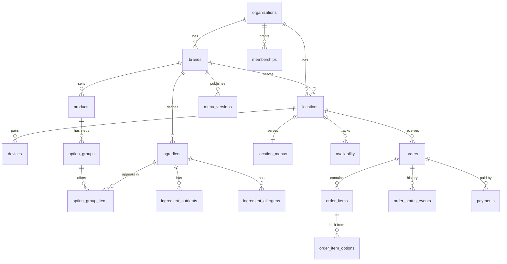

# Database

A complete, tested PostgreSQL schema for the kiosk system. It runs on Supabase, and the core file (`schema.sql`) also runs on any Postgres 15+.

| File | What it is |
|---|---|
| `schema.sql` | Tables, constraints, indexes, Row Level Security, audit log, realtime fan-out, and the RPC functions (`place_order`, `set_order_status`, `set_availability`, `publish_menu`, `set_location_menu`, `device_heartbeat`, `pickup_board`) |
| `supabase.sql` | Supabase-only wiring: Realtime channel authorization, `pg_cron` jobs, storage bucket |
| `seed.sql` | Generated from `../data/seed-menu.json` by `generate-seed.mjs`. Don't edit by hand |
| `tests/` | 60 behaviour and security tests, plus stubs so they run on plain Postgres |

## Run the tests

```bash
database/tests/run-local.sh            # needs PostgreSQL 15+ and Node.js
```

It creates a throwaway database, loads everything, runs the tests and drops the database. On Supabase, the same checks can be ported to pgTAP and run with `supabase test db`.

## Design decisions

- **Multi-tenant from day one:** organization → brand → location. Every row is reachable from an organization, and RLS keeps organizations apart.
- **Everyone signs in, including devices.** Pairing a kiosk creates an auth user for it with no password. The `devices` table links the auth user to a location and kind (`kiosk`, `kds`, `pickup`, `print_bridge`). Revoking a device cuts access instantly. The `anon` role gets nothing.
- **Kiosks can't write orders.** Only the `place-order` Edge Function (service role) calls `place_order`, after recomputing every price and nutrition value with the shared TypeScript core. The function is atomic and idempotent (`unique (device_id, idempotency_key)`), allocates order numbers per location and business day without gaps or races, and checks that totals add up.
- **Generic products.** A bowl is a `configurable` product with ordered `option_groups` (base, protein, ...). Salads, wraps, smoothies and protein cups use the same tables. Drinks are `simple` products.
- **Open reference sets.** Nutrients, allergens (US 9, EU 14 and Canada) and diet tags are rows, not enums, so adding sodium-style warnings, new allergens or new regions needs no migration.
- **Published menus are immutable JSON snapshots** (`menu_versions`) with a SHA-256 for caching. `location_menus` points each location at a version, which allows staged rollouts and instant rollback.
- **Orders snapshot everything:** names, portions, grams, prices and nutrition, so menu changes never alter history.
- **Money:** integer minor units plus an ISO 4217 currency on the location. Tax can be exclusive (US) or inclusive (VAT countries).
- **Privacy:** names and allergy notes are purged after 30 days. The pickup board can only see order number, first name + initial and status.
- **Realtime:** small payloads on private per-location topics (`location:<id>:orders`, `:availability`, `:menu`) through Supabase's Broadcast from Database. Clients refetch details through RLS.
- **Outbox:** `integration_outbox` rows are written in the same transaction as the order, for label printers, POS sync, receipts and webhooks. It can be swapped for Supabase Queues (pgmq).
- **Analytics** events are partitioned by month and old partitions are dropped after 13 months.
- **Audit log:** every menu, price, availability, location and membership change is recorded with the person who made it.
- **Performance:** RLS uses `security definer` helpers evaluated once per query, and every foreign key is indexed.

## Main tables


